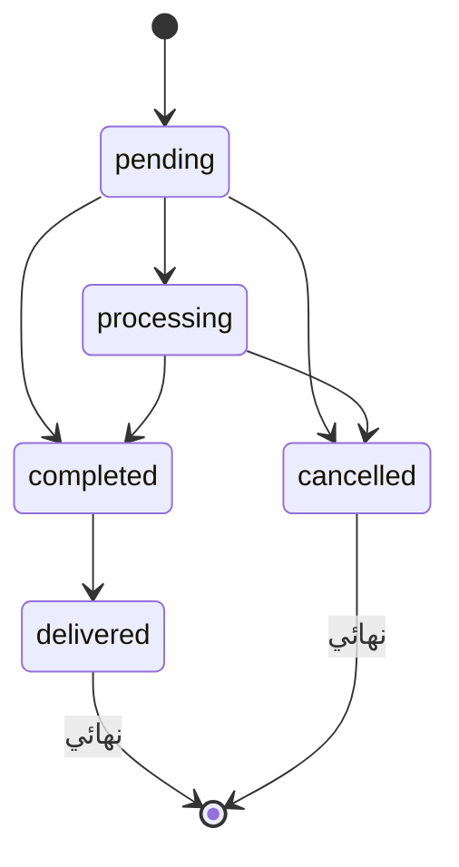
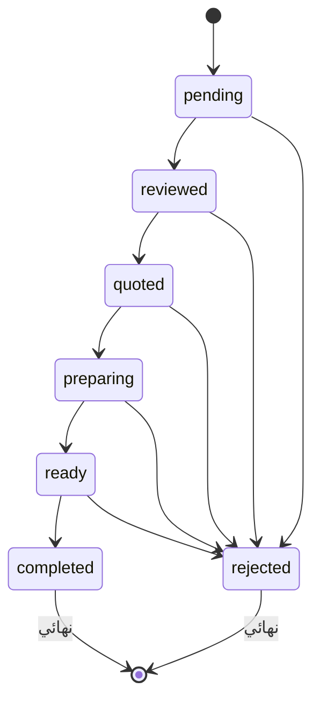

# عينات الـ API الحقيقية (main) — مرجع للتنفيذ

> **مرجع للـ Agent وللتنفيذ:**  
> عينات حقيقية تم سحبها والتحقق منها مباشرة من نسخة `main` (بفروع) على السيرفر المحلي ببيانات تجريبية.  
> **Base URL المحلي:** `http://localhost:5000/api`  
> جميع القوائم ومصفوفات الردود في هذا المرجع مختصرة لعنصر واحد لتسهيل قراءة الـ Models وبناء الـ DTOs/Entities.

---

## 1. الاتصال والجلسة (Auth & Session)

### 1.1 الـ JWT وإدارة الكوكيز
- الـ JWT يتم إرساله وحفظه تلقائيًا في كوكي باسم **`token`**:
  - `Max-Age=31536000` (صلاحية سنة كاملة)
  - الخصائص: `HttpOnly; SameSite=Lax`
  - **تنبيه هام:** التوكن **لا** يُعاد داخل رد الـ JSON إطلاقاً.
  - الـ JWT يحتوي على الحقول: `id`, `iat`, `exp` فقط.
- الدور (`role`) **ليس موجوداً** داخل الـ token، للحصول عليه استدعِ: `GET /auth/me`.

### 1.2 تحديد الفرع (Branch Context)
- **الموظف (Staff):** يتم تحديد الفرع تلقائياً من `user.branchId`.
- **المدير العام (Superadmin):** يمرر معرف الفرع عبر الهيدر:
  ```http
  X-Branch-Id: <branchId>
  ```
- **العميل (Customer):** يمرر معرف الفرع في الـ `query` أو الـ `body` (`branchId`).

---

## 2. صلاحيات الـ Routes الحقيقية (من الكود الفعلي)

> [!NOTE]
> الـ `superadmin` يتجاوز كافة قيود الصلاحيات (`authorize`).

| الـ Route | Methods | الصلاحيات المطلوبة | ملاحظات هامة |
| :--- | :--- | :--- | :--- |
| `/products` | `POST` | `admin` فقط | الصيدلي ممنوع من إنشاء منتج |
| `/products/:id` | `PUT`, `DELETE` | `admin` فقط | الصيدلي ممنوع من التعديل أو الحذف |
| `/products/upload-image` | `POST` | `admin` فقط | رفع صورة منتج |
| `/products/auto-fetch-images` | `POST` | `admin`, `superadmin` | جلب صور تلقائي |
| `/products/fetch-single-image` | `POST` | `admin`, `superadmin` | جلب صورة مفردة |
| `/products` | `GET` | `protect` فقط | متاح لأي مستخدم مسجل |
| `/products/:id` | `GET` | `protect` فقط | متاح لأي مستخدم مسجل |
| `/products/shortages-insights` | `GET` | `admin`, `pharmacist` | نواقص المنتجات |
| `/reports/*` | `GET` | `admin`, `pharmacist` | تشمل (daily, monthly, top-products, expiry-alerts, low-stock, shortages, financial-analysis, targets) |
| `/branches` | `GET` | `superadmin`, `admin`, `pharmacist` | قراءة الفروع للموظفين |
| `/branches` | `POST`, `PUT` | `superadmin` فقط | إدارة وإنشاء الفروع |

> [!IMPORTANT]
> **قيد ربط الموظف بالفرع:**  
> الموظف غير الـ `superadmin` **يجب** أن يكون حسابه مربوطاً بفرع (`user.branchId` ليس فارغاً)، وإلا سيعيد السيرفر خطأ `403`:  
> `{"message": "يجب ربط المستخدم بفرع أولاً"}`

> [!CAUTION]
> **تنبيه أمان وملاحظة سلوكية:**  
> - استدعاء `GET /products` بواسطة حساب عميل (`customer`) رجّع `403` لأن العميل غير مربوط بفرع، وليس لأن الـ route محمي ضد العملاء.  
> - `GET /products/:id` محمي بـ `protect` فقط، لذا قد يكون متاحاً للعميل (يُرجى مراعاة اختباره).

---

## 3. معاملات وأجسام إضافية (من الكود)

### 3.1 تحديث الملف الشخصي `PUT /auth/profile`
تحديث جزئي (Partial Update)؛ كل حقل اختياري:
- `name`: نص (إذا أُرسل يجب ألا يكون فارغاً).
- `phone`: نص (إرسال `null` أو `""` يقوم بمسح رقم الهاتف).
- `address`: نص (إرسال `null` أو `""` يقوم بمسح العنوان).
*(ملاحظة: أي حقول إضافية بعد السطر 552 في كود السيرفر لم تُقرأ بعد).*

### 3.2 البحث عن عميل في الـ POS `GET /customers/lookup?phone=xxx`
```http
GET /customers/lookup?phone=xxx
```
- **الصلاحيات:** `Admin`, `Pharmacist`, `Superadmin` (العميل ممنوع `403`).
- **المعاملات:** `phone` إجباري (أقل طول 3 أحرف بعد التنظيف).
- **الردود المحققة:**
  - `200 OK`: يعيد كائن العميل الكامل داخل `data` (انظر §9.11).
  - `400 Bad Request`: عند إرسال رقم أقل من 3 أحرف `{"message": "Phone number too short"}`.
  - `404 Not Found`: إذا لم يتم العثور على العميل `{"message": "Customer not found"}`.


### 3.3 معاملات المنتجات الداخلية `GET /products`
Query Parameters:
- `keyword`: بحث جزئي (contains) في الاسم أو الباركود (مسح الباركود مدعوم تلقائياً عبر `keyword`).
- `scientificName`: بحث منفصل في الاسم العلمي.
- `minPrice`, `maxPrice`: تصفية حسب نطاق سعر البيع.
*(المعاملات الأخرى مثل `page`, `limit`, `category`, `inStockOnly` مدمجة).*

---

## 4. الحالات ودورة الحياة (State Transitions)

### 4.1 حالات الطلب (Order Status Lifecycle)
يتم التحديث عبر: `PUT /orders/:id/status`  
Body: `{"status": "..."}` *(القيمة يتم تحويلها تلقائياً إلى lowercase)*.



- `pending` $\rightarrow$ `processing` | `completed` | `cancelled`
- `processing` $\rightarrow$ `completed` | `cancelled`
- `completed` $\rightarrow$ `delivered`
- `delivered` $\rightarrow$ حالة نهائية
- `cancelled` $\rightarrow$ حالة نهائية

---

### 4.2 حالات ومراجعة الروشتة (Prescription Review Lifecycle)
يتم التحديث عبر: `PUT /prescriptions/:id/review`  
Body يقبل: `status`, `pharmacistNotes`, `quotedPrice`, `items`, `rejectionReason` *(حقل `status` اختياري)*.



**قيم `status` المسموحة أثناء المراجعة:**
`reviewed`, `quoted`, `preparing`, `ready`, `completed`, `rejected`.
- `pending` $\rightarrow$ `reviewed` | `rejected`
- `reviewed` $\rightarrow$ `quoted` | `rejected`
- `quoted` $\rightarrow$ `preparing` | `rejected`
- `preparing` $\rightarrow$ `ready` | `rejected`
- `ready` $\rightarrow$ `completed` | `rejected`
- `completed`, `rejected` $\rightarrow$ حالات نهائية

---

### 4.3 إغلاق الوردية (Shift Close)
يتم عبر: `POST /shifts/close`  
Body:
```json
{
  "endingCash": 250,
  "endingVisa": 50,
  "notes": "ملاحظات الإغلاق إن وجدت"
}
```

---

## 5. صيغ الأخطاء والرسائل (Error Responses)

> [!NOTE]
> رسائل الخطأ من السيرفر باللغة العربية دائماً.  
> المفتاح `message` متواجد دائماً، بينما المفتاح `success` يتواجد أحياناً.

| كود الخطأ | الحالة | استجابة السيرفر |
| :--- | :--- | :--- |
| **401** | كلمة مرور خاطئة | `{"message":"البريد الإلكتروني أو كلمة المرور غير صحيحة"}` |
| **401** | بدون كوكي أو جلسة | `{"message":"غير مصرح لك بالوصول، يرجى تسجيل الدخول أولاً"}` |
| **400** | طلب متجر بدون تحديد فرع | `{"success":false,"message":"يرجى اختيار الفرع لعرض مخزون المتجر"}` |
| **403** | وصول عميل لـ endpoint موظفين | `{"message":"صلاحية (customer) غير كافية للقيام بهذا الإجراء"}` |
| **403** | موظف غير مرتبط بفرع | `{"message":"يجب ربط المستخدم بفرع أولاً"}` |

---

## 6. عينات المصادقة والحسابات (Auth Samples)

### 6.1 تسجيل الدخول `POST /auth/login`
نفس شكل الاستجابة ينطبق على `POST /auth/register`.

**Request:**
```json
{
  "email": "pharmacist@test.com",
  "password": "Password123"
}
```

**Response:**
```json
{
  "success": true,
  "user": {
    "id": "cbf82a14-8742-4f11-9a7c-179326d91012",
    "name": "Test Pharmacist",
    "email": "pharmacist@test.com",
    "role": "pharmacist",
    "phone": null,
    "address": null,
    "permissions": null,
    "branchId": "b18f3a22-3118-4089-9e8c-529a6e118901"
  }
}
```

---

### 6.2 جلب بيانات المستخدم الحالي `GET /auth/me`
> [!WARNING]
> **اختلاف في التسمية:** الرد يعيد الكائن في مفتاح `data` وليس `user`.

**Response:**
```json
{
  "success": true,
  "data": {
    "id": "e98df12a-3312-40bb-97dc-712891bcfa10",
    "name": "Ahmed Mostafa",
    "email": "customer@test.com",
    "phone": "01012345678",
    "address": null,
    "role": "customer",
    "isActive": true,
    "permissions": null,
    "monthlyTarget": 0,
    "branchId": null,
    "createdAt": "2026-10-10T12:00:00.000Z"
  }
}
```

---

### 6.3 تسجيل عميل جديد `POST /auth/register` (Customer فقط)
**Request Body:**
```json
{
  "name": "Customer Name",
  "email": "customer@test.com",
  "password": "Password123",
  "phone": "01000000000",
  "address": "Cairo, Egypt"
}
```
*(كلمة المرور يجب أن تكون 8 أحرف على الأقل، الحقول `phone` و `address` اختيارية).*

---

### 6.4 تسجيل موظف جديد `POST /auth/register-staff` (Superadmin فقط)
**Request Body:**
```json
{
  "name": "Staff Name",
  "email": "staff@test.com",
  "password": "Password123",
  "role": "pharmacist",
  "branchId": "b18f3a22-3118-4089-9e8c-529a6e118901",
  "phone": "01011111111",
  "monthlyTarget": 50000
}
```
*(الأدوار المسموحة: `admin` | `pharmacist` | `superadmin`).*

**Response:**
```json
{
  "success": true,
  "user": {
    "id": "d09f7a11-8843-4a11-9a7c-229326d91012",
    "name": "Staff Name",
    "email": "staff@test.com",
    "phone": "01011111111",
    "role": "pharmacist",
    "monthlyTarget": 50000,
    "branchId": "b18f3a22-3118-4089-9e8c-529a6e118901",
    "isActive": true
  }
}
```

---

### 6.5 تحديث صلاحيات الموظف `PUT /users/:id/permissions` (Superadmin فقط)
**Request Body (Object فقط):**
```json
{
  "permissions": {
    "editPrice": false,
    "manageTransfers": true,
    "viewPrescriptions": true,
    "viewReports": true,
    "viewReturns": true
  }
}
```

> **مفاتيح الصلاحيات المستخدمة في الويب (كلها boolean):**
> - `editPrice`: تعديل سعر المنتج أثناء البيع.
> - `manageTransfers`: إدارة تحويلات الأصناف بين الفروع.
> - `viewPrescriptions`: الاطلاع على الروشتات ومراجعتها.
> - `viewReports`: الاطلاع على التقارير المالية والتحليلات.
> - `viewReturns`: الاطلاع على المرتجعات ومعالجتها.
> *(الصلاحية تكون مفعّلة فقط عندما تكون القيمة `=== true`).*

---

## 7. متجر العملاء العام (Store Public)

### 7.1 فروع المتجر `GET /store/branches`
**Response:**
```json
{
  "success": true,
  "count": 1,
  "data": [
    {
      "id": "b18f3a22-3118-4089-9e8c-529a6e118901",
      "name": "Main Branch",
      "address": "Cairo",
      "phone": "01012345678"
    }
  ]
}
```

---

### 7.2 تصنيفات المتجر `GET /store/categories`
**Response:**
```json
{
  "success": true,
  "count": 2,
  "data": [
    {
      "id": "c10f8a91-4418-4089-9e8c-779a6e118902",
      "name": "Skincare"
    }
  ]
}
```

---

### 7.3 منتجات المتجر `GET /store/products?branchId=&page=&limit=&keyword=&category=`
> [!NOTE]
> معلمات الترقيم في الاستور: `total`, `totalPages`, `page`, `limit`.

**Response:**
```json
{
  "success": true,
  "count": 3,
  "total": 3,
  "page": 1,
  "limit": 5,
  "totalPages": 1,
  "branchId": "b18f3a22-3118-4089-9e8c-529a6e118901",
  "data": [
    {
      "id": "p01f8a22-1118-4089-9e8c-669a6e118999",
      "name": "Hydrating Cream 50ml",
      "scientificName": "Hyaluronic Acid",
      "barcode": "6221000000028",
      "description": "Daily moisturizing cream for dry and sensitive skin",
      "image": null,
      "sellingPrice": 130,
      "stockQuantity": 30,
      "expiryDate": "2028-06-30T00:00:00.000Z",
      "requiresPrescription": false,
      "unit": "قطعة",
      "category": {
        "id": "c10f8a91-4418-4089-9e8c-779a6e118902",
        "name": "Skincare"
      },
      "looseQuantity": 0,
      "branchId": "b18f3a22-3118-4089-9e8c-529a6e118901"
    }
  ]
}
```

---

### 7.4 تفاصيل منتج متجر `GET /store/products/:id?branchId=`
**Response:**
```json
{
  "success": true,
  "data": {
    "id": "p01f8a22-1118-4089-9e8c-669a6e118999",
    "name": "Hydrating Cream 50ml",
    "scientificName": "Hyaluronic Acid",
    "barcode": "6221000000028",
    "description": "Daily moisturizing cream for dry and sensitive skin",
    "image": null,
    "sellingPrice": 130,
    "stockQuantity": 30,
    "expiryDate": "2028-06-30T00:00:00.000Z",
    "requiresPrescription": false,
    "unit": "قطعة",
    "category": {
      "id": "c10f8a91-4418-4089-9e8c-779a6e118902",
      "name": "Skincare"
    },
    "looseQuantity": 0,
    "branchId": "b18f3a22-3118-4089-9e8c-529a6e118901"
  }
}
```
*(حقل `category` قد يعود `null` إذا لم يُربط المنتج بتصنيف).*

---

### 7.5 الإعدادات العامة `GET /settings/public`
**Response:**
```json
{
  "success": true,
  "data": {}
}
```
*(يكون الكائن فارغاً `{}` عند عدم ضبط إعدادات عامة في السيرفر).*

> [!NOTE]
> **التقييمات (Reviews):** غير موجودة في الـ `main` حالياً (ترجع `404`) — مؤجلة لمرحلة قادمة (D.09).

---

## 8. طلبات العميل والروشتة (Customer Orders & Prescriptions)

### 8.1 إنشاء طلب أونلاين `POST /store/orders`
**Request Body:**
```json
{
  "branchId": "b18f3a22-3118-4089-9e8c-529a6e118901",
  "orderItems": [
    {
      "productId": "p02f8a22-2228-4089-9e8c-669a6e118988",
      "quantity": 2
    }
  ],
  "deliveryAddress": "Nasr City, Cairo, Building 4",
  "customerPhone": "01012345678",
  "notes": "يرجى الاتصال قبل الوصول"
}
```

**Response:**
```json
{
  "success": true,
  "data": {
    "id": "ord-887123aa-9912-4f81-81b3-4412398fa101",
    "orderNumber": "ONL-20261018-001",
    "customerId": "e98df12a-3312-40bb-97dc-712891bcfa10",
    "branchId": "b18f3a22-3118-4089-9e8c-529a6e118901",
    "subtotal": 170,
    "totalAmount": 170,
    "paidAmount": 0,
    "dueAmount": 170,
    "changeAmount": 0,
    "orderType": "ONLINE",
    "status": "pending",
    "paymentMethod": "cash",
    "deliveryAddress": "Nasr City, Cairo, Building 4",
    "customerPhone": "01012345678",
    "notes": "يرجى الاتصال قبل الوصول",
    "createdAt": "2026-10-18T12:30:00.000Z",
    "items": [
      {
        "id": "item-01",
        "orderId": "ord-887123aa-9912-4f81-81b3-4412398fa101",
        "productId": "p02f8a22-2228-4089-9e8c-669a6e118988",
        "productName": "Vitamin C 1000mg",
        "quantity": 2,
        "priceAtPurchase": 85,
        "costAtSale": 60,
        "isUnit": false,
        "isSecondaryUnit": false
      }
    ]
  }
}
```

> [!CAUTION]
> **ملاحظة أمان للمطور:**  
> استجابة إنشاء الطلب (`POST /store/orders`) تُعيد حقل `costAtSale` (تكلفة الشراء الأصلية للمنتج) للعميل، بينما قائمة طلباتي (`GET /store/orders/my`) لا تعيده. تم إبلاغ مطور الـ Backend بمعالجة هذا التسريب.

---

### 8.2 قائمة طلباتي للعميل `GET /store/orders/my`
**Response:**
```json
{
  "success": true,
  "count": 1,
  "total": 1,
  "page": 1,
  "limit": 3,
  "totalPages": 1,
  "data": [
    {
      "id": "ord-887123aa-9912-4f81-81b3-4412398fa101",
      "orderNumber": "ONL-20261018-001",
      "subtotal": 170,
      "discountType": "fixed",
      "discountValue": 0,
      "totalAmount": 170,
      "paidAmount": 0,
      "dueAmount": 170,
      "changeAmount": 0,
      "orderType": "ONLINE",
      "status": "pending",
      "paymentMethod": "cash",
      "deliveryAddress": "Nasr City, Cairo, Building 4",
      "customerPhone": "01012345678",
      "notes": "يرجى الاتصال قبل الوصول",
      "createdAt": "2026-10-18T12:30:00.000Z",
      "updatedAt": "2026-10-18T12:30:00.000Z",
      "items": [
        {
          "id": "item-01",
          "productId": "p02f8a22-2228-4089-9e8c-669a6e118988",
          "productName": "Vitamin C 1000mg",
          "quantity": 2,
          "priceAtPurchase": 85,
          "isUnit": false
        }
      ]
    }
  ]
}
```

---

### 8.3 رفع صورة روشتة `POST /prescriptions/upload-image`
- الطلب بصيغة `multipart/form-data` مع حقل الملف باسم: **`image`**.

**Response:**
```json
{
  "success": true,
  "data": {
    "image": "/uploads/prescriptions/rx-1729251845123-981241.png",
    "filename": "rx-1729251845123-981241.png",
    "mimeType": "image/png",
    "size": 70142,
    "extension": ".png"
  }
}
```

---

### 8.4 إرسال روشتة جديدة `POST /prescriptions`
**Request Body:**
```json
{
  "imageUrl": "/uploads/prescriptions/rx-1729251845123-981241.png",
  "notes": "يرجى توفير البديل إذا كان الصنف ناقصاً"
}
```

**Response:**
```json
{
  "success": true,
  "data": {
    "id": "rx-771239aa-0012-4f81-99b3-1112398fa202",
    "prescriptionNumber": "RX-20261018-005",
    "customerId": "e98df12a-3312-40bb-97dc-712891bcfa10",
    "imageUrl": "/uploads/prescriptions/rx-1729251845123-981241.png",
    "notes": "يرجى توفير البديل إذا كان الصنف ناقصاً",
    "status": "pending",
    "pharmacistId": null,
    "pharmacistNotes": null,
    "quotedPrice": null,
    "customerResponse": null,
    "rejectionReason": null,
    "createdAt": "2026-10-18T13:00:00.000Z",
    "updatedAt": "2026-10-18T13:00:00.000Z",
    "customer": {
      "name": "Ahmed Mostafa",
      "phone": "01012345678",
      "email": "customer@test.com"
    }
  }
}
```

---

## 9. عمليات الموظف (Staff Operations: Shifts, POS, Internal Orders, Reports)

### 9.1 الوردية الحالية `GET /shifts/current`
> ملاحظة: إذا لم تكن هناك وردية مفتوحة، يعود الرد بـ `"data": null`.

**Response (عند وجود وردية مفتوحة):**
```json
{
  "success": true,
  "data": {
    "id": "shf-110293aa-5512-4f81-81b3-9912398fa999",
    "pharmacistId": "cbf82a14-8742-4f11-9a7c-179326d91012",
    "branchId": "b18f3a22-3118-4089-9e8c-529a6e118901",
    "startTime": "2026-10-18T08:00:00.000Z",
    "endTime": null,
    "startingCash": 100,
    "endingCash": null,
    "expectedCash": 230,
    "endingVisa": null,
    "expectedVisa": 0,
    "totalSales": 130,
    "totalOrders": 1,
    "totalReturns": 0,
    "status": "open",
    "notes": null,
    "pharmacist": {
      "name": "Test Pharmacist"
    },
    "grossSales": 130,
    "netSales": 130,
    "cashSales": 130,
    "cashReturns": 0,
    "netCashSales": 130,
    "visaSales": 0,
    "digitalSales": 0
  }
}
```

- **فتح وردية:** `POST /shifts/open` بـ Body: `{"startingCash": 100}`
- **إغلاق وردية:** `POST /shifts/close` بـ Body: `{"endingCash": 230, "endingVisa": 0, "notes": "تم التقفيل"}`

---

### 9.2 إنشاء فاتورة نقطة بيع `POST /orders` (POS)
> [!IMPORTANT]
> إنشاء فاتورة POS يتطلب **حتماً** وجود وردية مفتوحة حالياً في نفس فرع الصيدلي.

**Request Body:**
```json
{
  "orderItems": [
    {
      "productId": "p01f8a22-1118-4089-9e8c-669a6e118999",
      "quantity": 1,
      "isUnit": false,
      "isSecondaryUnit": false
    }
  ],
  "orderType": "POS",
  "paymentMethod": "cash",
  "discountType": "fixed",
  "discountValue": 0,
  "paidAmount": 130,
  "customerPhone": null,
  "customerId": null,
  "splitCash": 0,
  "splitCard": 0,
  "splitInstapay": 0,
  "splitVodafoneCash": 0
}
```

**Response:**
```json
{
  "message": "Order created successfully",
  "success": true,
  "data": {
    "id": "ord-pos-998811-aa",
    "orderNumber": "ORD-20261018-010",
    "pharmacistId": "cbf82a14-8742-4f11-9a7c-179326d91012",
    "customerId": null,
    "shiftId": "shf-110293aa-5512-4f81-81b3-9912398fa999",
    "branchId": "b18f3a22-3118-4089-9e8c-529a6e118901",
    "subtotal": 130,
    "discountType": "fixed",
    "discountValue": 0,
    "totalAmount": 130,
    "paidAmount": 130,
    "dueAmount": 0,
    "changeAmount": 0,
    "orderType": "POS",
    "status": "completed",
    "paymentMethod": "cash",
    "splitCash": 0,
    "splitCard": 0,
    "splitInstapay": 0,
    "splitVodafoneCash": 0,
    "customerPhone": null,
    "deliveryAddress": null,
    "notes": null,
    "createdAt": "2026-10-18T14:15:00.000Z",
    "items": [
      {
        "productName": "Hydrating Cream 50ml",
        "quantity": 1,
        "priceAtPurchase": 130,
        "costAtSale": 90,
        "isUnit": false,
        "isSecondaryUnit": false
      }
    ],
    "branch": {
      "id": "b18f3a22-3118-4089-9e8c-529a6e118901",
      "name": "Main Branch"
    }
  },
  "order": {
    "id": "ord-pos-998811-aa",
    "orderNumber": "ORD-20261018-010"
  }
}
```
*(لاحظ أن الرد يكرر بيانات الفاتورة في المفتاحين `data` و `order`).*

---

### 9.3 طلبات الفرع الداخلية `GET /orders`
> [!WARNING]
> لا يوجد Pagination في قائمة الطلبات الداخلية، ويتم تكرار القائمة داخل `data` و `orders`.

**Response:**
```json
{
  "success": true,
  "count": 2,
  "data": [
    {
      "id": "ord-pos-998811-aa",
      "orderNumber": "ORD-20261018-010",
      "pharmacistId": "cbf82a14-8742-4f11-9a7c-179326d91012",
      "customerId": null,
      "shiftId": "shf-110293aa-5512-4f81-81b3-9912398fa999",
      "branchId": "b18f3a22-3118-4089-9e8c-529a6e118901",
      "subtotal": 130,
      "totalAmount": 130,
      "paidAmount": 130,
      "dueAmount": 0,
      "orderType": "POS",
      "status": "completed",
      "paymentMethod": "cash",
      "createdAt": "2026-10-18T14:15:00.000Z",
      "items": [
        {
          "id": "it-1",
          "quantity": 1,
          "priceAtPurchase": 130,
          "product": {
            "id": "p01f8a22-1118-4089-9e8c-669a6e118999",
            "name": "Hydrating Cream 50ml",
            "barcode": "6221000000028"
          }
        }
      ],
      "pharmacist": {
        "id": "cbf82a14-8742-4f11-9a7c-179326d91012",
        "name": "Test Pharmacist"
      },
      "customer": null,
      "shift": {
        "id": "shf-110293aa-5512-4f81-81b3-9912398fa999",
        "status": "open"
      },
      "branch": {
        "id": "b18f3a22-3118-4089-9e8c-529a6e118901",
        "name": "Main Branch"
      }
    }
  ],
  "orders": [
    {
      "id": "ord-pos-998811-aa",
      "orderNumber": "ORD-20261018-010"
    }
  ]
}
```

---

### 9.4 الطلبات الأونلاين للفرع `GET /orders/online`
**Response:**
```json
{
  "success": true,
  "count": 1,
  "activeShift": null,
  "branchId": "b18f3a22-3118-4089-9e8c-529a6e118901",
  "data": [
    {
      "id": "ord-887123aa-9912-4f81-81b3-4412398fa101",
      "orderNumber": "ONL-20261018-001",
      "pharmacist": null,
      "orderType": "ONLINE",
      "status": "pending",
      "totalAmount": 170
    }
  ],
  "orders": [
    {
      "id": "ord-887123aa-9912-4f81-81b3-4412398fa101"
    }
  ]
}
```
*(ملاحظة: `pharmacist: null` للطلبات الأونلاين الواردة حديثاً قبل تخصيصها لموظف).*

---

### 9.5 استعراض الروشتات للموظف `GET /prescriptions`
**Response:**
```json
{
  "success": true,
  "count": 1,
  "data": [
    {
      "id": "rx-771239aa-0012-4f81-99b3-1112398fa202",
      "prescriptionNumber": "RX-20261018-005",
      "customerId": "e98df12a-3312-40bb-97dc-712891bcfa10",
      "imageUrl": "/uploads/prescriptions/rx-1729251845123-981241.png",
      "notes": "يرجى توفير البديل إذا كان الصنف ناقصاً",
      "status": "pending",
      "pharmacistId": null,
      "pharmacistNotes": null,
      "quotedPrice": null,
      "customerResponse": null,
      "rejectionReason": null,
      "createdAt": "2026-10-18T13:00:00.000Z",
      "updatedAt": "2026-10-18T13:00:00.000Z",
      "customer": {
        "name": "Ahmed Mostafa",
        "email": "customer@test.com",
        "phone": "01012345678"
      },
      "pharmacist": null,
      "items": []
    }
  ]
}
```

---

### 9.6 قائمة المنتجات الداخلية للموظف `GET /products?limit=`
> [!NOTE]
> معلمات الترقيم في قائمة المنتجات الداخلية: `totalCount` و `hasMore` (بدلاً من `total` و `totalPages` المستخدمة بالاستور).

**Response:**
```json
{
  "success": true,
  "count": 3,
  "totalCount": 3,
  "page": 1,
  "limit": 3,
  "hasMore": false,
  "data": [
    {
      "id": "p01f8a22-1118-4089-9e8c-669a6e118999",
      "name": "Hydrating Cream 50ml",
      "scientificName": "Hyaluronic Acid",
      "barcode": "6221000000028",
      "description": "Daily moisturizing cream",
      "image": null,
      "categoryId": "c10f8a91-4418-4089-9e8c-779a6e118902",
      "purchasingPrice": 90,
      "sellingPrice": 130,
      "expiryDate": "2028-06-30T00:00:00.000Z",
      "requiresPrescription": false,
      "isAvailableOnline": true,
      "unit": "قطعة",
      "isSplittable": false,
      "unitsPerBox": 1,
      "unitName": "علبة",
      "unitPrice": 130,
      "hasSecondaryUnit": false,
      "secondaryUnitsPerUnit": 0,
      "secondaryUnitName": null,
      "secondaryUnitPrice": 0,
      "supplierId": "sup-01",
      "stockQuantity": 30,
      "minStockAlert": 5,
      "looseQuantity": 0,
      "createdAt": "2026-10-01T10:00:00.000Z",
      "updatedAt": "2026-10-18T11:00:00.000Z",
      "category": {
        "id": "c10f8a91-4418-4089-9e8c-779a6e118902",
        "name": "Skincare"
      },
      "supplier": {
        "id": "sup-01",
        "name": "United Pharma"
      },
      "branchStocks": [
        {
          "id": "bs-01",
          "productId": "p01f8a22-1118-4089-9e8c-669a6e118999",
          "branchId": "b18f3a22-3118-4089-9e8c-529a6e118901",
          "stockQuantity": 30,
          "looseQuantity": 0,
          "averageCost": 90,
          "inTransitQuantity": 0,
          "minStockAlert": 5
        }
      ]
    }
  ]
}
```

---

### 9.7 التقرير اليومي `GET /reports/daily`
**Response:**
```json
{
  "success": true,
  "data": {
    "date": "2026-10-15T21:00:00.000Z",
    "totalSales": 130,
    "grossSales": 130,
    "totalReturns": 0,
    "netSales": 130,
    "cashSales": 130,
    "cardSales": 0,
    "creditSales": 0,
    "totalOrders": 1,
    "posOrders": 1,
    "onlineOrders": 0,
    "salesCOGS": 90,
    "returnsCOGS": 0,
    "cogs": 90,
    "totalExpenses": 0,
    "grossProfit": 40,
    "operatingProfit": 40,
    "netProfit": 40,
    "netRevenue": 130
  }
}
```

---

### 9.8 التقرير الشهري `GET /reports/monthly`
- **Query Parameters:** `year` (2000–2100، اختياري، الافتراضي: السنة الحالية بتوقيت القاهرة)، `month` (1–12، اختياري، الافتراضي: الشهر الحالي).
- **تحديد الفرع:** للصيدلي/المدير يُحدد تلقائياً من `user.branchId`، وللـ superadmin عبر `X-Branch-Id` (أو إجمالي لكافة الفروع عند حذفه).
- **الصلاحيات:** `Admin`, `Pharmacist`, `Superadmin`.

**Response:**
```json
{
  "success": true,
  "data": {
    "year": 2026,
    "month": 10,
    "totalSales": 130,
    "grossSales": 130,
    "totalReturns": 0,
    "netSales": 130,
    "totalOrders": 1,
    "salesCOGS": 90,
    "returnsCOGS": 0,
    "cogs": 90,
    "totalExpenses": 0,
    "grossProfit": 40,
    "operatingProfit": 40,
    "netProfit": 40,
    "netRevenue": 130,
    "dailyBreakdown": [
      {
        "_id": 16,
        "totalSales": 130,
        "grossSales": 130,
        "totalReturns": 0,
        "netSales": 130,
        "orderCount": 1
      }
    ],
    "expenseBreakdown": []
  }
}
```

---

### 9.9 المنتجات الأكثر مبيعاً `GET /reports/top-products`
- **Query Parameters:** `days` (اختياري، الافتراضي: 30، الحد الأقصى: 3650)، `limit` (اختياري، الافتراضي: 10، الحد الأقصى: 100).
- **تحديد الفرع:** للصيدلي/المدير يُحدد من `user.branchId`، وللـ superadmin عبر `X-Branch-Id` (أو إجمالي لكافة الفروع عند حذفه).
- **الصلاحيات:** `Admin`, `Pharmacist`, `Superadmin`.

**Response:**
```json
{
  "success": true,
  "data": [
    {
      "_id": "cmv9mnyoi0006wqgoyfa9mv60",
      "productName": "Hydrating Cream 50ml",
      "quantityUnit": "base",
      "grossQuantity": 1,
      "returnedQuantity": 0,
      "totalQuantity": 1,
      "grossRevenue": 130,
      "returnedRevenue": 0,
      "totalRevenue": 130
    }
  ]
}
```

---

### 9.10 تنبيهات الصلاحية `GET /reports/expiry-alerts`
- **Query Parameters:** `days` (اختياري، الافتراضي: 90، الحد الأقصى: 3650).
- **تحديد الفرع:** للصيدلي/المدير يُحدد من `user.branchId`، وللـ superadmin عبر `X-Branch-Id` (أو إجمالي لكافة الفروع عند حذفه).
- **الصلاحيات:** `Admin`, `Pharmacist`, `Superadmin`.
- **ملاحظة:** يُرجع مصفوفة `expired` (منتهية الصلاحية) ومصفوفة `expiringSoon` (ستنتهي خلال عدد الأيام المحدد) مع إجمالي التنبيهات `totalAlerts`.

**Response:**
```json
{
  "success": true,
  "data": {
    "expired": [
      {
        "id": "cmv9mnym50004wqgopr2luret",
        "name": "Vitamin C 1000mg",
        "scientificName": "Ascorbic Acid",
        "barcode": "6221000000011",
        "description": "Vitamin C effervescent tablets",
        "image": null,
        "categoryId": "cmv9bxrw70002wqgo7j1crx4h",
        "purchasingPrice": 60,
        "sellingPrice": 85,
        "expiryDate": "2026-10-01T00:00:00.000Z",
        "requiresPrescription": false,
        "isAvailableOnline": true,
        "unit": "قطعة",
        "isSplittable": false,
        "unitsPerBox": null,
        "unitName": null,
        "unitPrice": null,
        "hasSecondaryUnit": false,
        "secondaryUnitsPerUnit": null,
        "secondaryUnitName": null,
        "secondaryUnitPrice": null,
        "supplierId": null,
        "stockQuantity": 48,
        "minStockAlert": 10,
        "looseQuantity": 0,
        "createdAt": "2026-10-15T14:22:07.613Z",
        "updatedAt": "2026-10-15T14:22:07.613Z",
        "branchStocks": [
          {
            "id": "cmv9mnyna0005wqgo0um6qez2",
            "productId": "cmv9mnym50004wqgopr2luret",
            "branchId": "cmv9bxrvj0001wqgov68wj0wb",
            "stockQuantity": 48,
            "looseQuantity": 0,
            "averageCost": 60,
            "inTransitQuantity": 0,
            "minStockAlert": 10,
            "createdAt": "2026-10-15T14:22:07.654Z",
            "updatedAt": "2026-10-16T09:34:59.926Z"
          }
        ],
        "category": {
          "name": "Vitamins"
        }
      }
    ],
    "expiringSoon": [
      {
        "id": "cmv9mnyp80008wqgoepyhqdof",
        "name": "Amoxicillin 500mg",
        "scientificName": "Amoxicillin",
        "barcode": "6221000000035",
        "description": "Antibiotic capsules, prescription only",
        "image": null,
        "categoryId": null,
        "purchasingPrice": 40,
        "sellingPrice": 60,
        "expiryDate": "2026-11-20T00:00:00.000Z",
        "requiresPrescription": true,
        "isAvailableOnline": true,
        "unit": "قطعة",
        "isSplittable": true,
        "unitsPerBox": 10,
        "unitName": null,
        "unitPrice": 6,
        "hasSecondaryUnit": false,
        "secondaryUnitsPerUnit": null,
        "secondaryUnitName": null,
        "secondaryUnitPrice": null,
        "supplierId": null,
        "stockQuantity": 20,
        "minStockAlert": 5,
        "looseQuantity": 0,
        "createdAt": "2026-10-15T14:22:07.724Z",
        "updatedAt": "2026-10-15T14:22:07.724Z",
        "branchStocks": [
          {
            "id": "cmv9mnyp90009wqgoc9jbowcs",
            "productId": "cmv9mnyp80008wqgoepyhqdof",
            "branchId": "cmv9bxrvj0001wqgov68wj0wb",
            "stockQuantity": 20,
            "looseQuantity": 0,
            "averageCost": 40,
            "inTransitQuantity": 0,
            "minStockAlert": 5,
            "createdAt": "2026-10-15T14:22:07.725Z",
            "updatedAt": "2026-10-15T14:22:07.725Z"
          }
        ],
        "category": null
      }
    ],
    "totalAlerts": 2
  }
}
```

---

### 9.11 البحث عن عميل في الـ POS برقم الهاتف `GET /customers/lookup`
- **Query Parameters:** `phone` (إجباري، أقل طول 3 أحرف).
- **الصلاحيات:** `Admin`, `Pharmacist`, `Superadmin`.
- **أكواد الخطأ:**
  - `400 Bad Request`: `{"message": "Phone number too short"}`
  - `404 Not Found`: `{"message": "Customer not found"}`

**Response (200 OK):**
```json
{
  "success": true,
  "data": {
    "id": "cmvfft5h20000iagq0n4o12gz",
    "name": "Ahmed Mohamed",
    "phone": "<phone>",
    "loyaltyPoints": 0,
    "totalSpent": 0,
    "notes": "Test customer",
    "createdAt": "2026-10-19T15:56:49.526Z",
    "updatedAt": "2026-10-19T15:56:49.526Z"
  }
}
```

---

## 10. جدول الفروقات والتنبيهات الموجهة للمطور والـ Agent


| النقطة | تفاصيل السلوك الفعلي | التوصية عند كتابة الكود |
| :--- | :--- | :--- |
| **Pagination غير موحد** | الاستور يستخدم `total`, `totalPages`، بينما المنتجات الداخلية تستخدم `totalCount`, `hasMore`. | بناء DTOs منفصلة أو Generic Wrapper يتعامل مع الحالتين. |
| **قوائم بدون Pagination** | قوائم الطلبات الداخلية (`/orders`, `/orders/online`) والروشتات لا تحتوي Pagination حالياً. | فحص طول المصفوفة وعدم الاعتماد على page query params. |
| **تكرار الكائنات في الرد** | الردود في الـ POS وطلبات الفروع تكرر الكائن/القائمة في `data` و `order` أو `orders`. | الاعتماد على `data` كمصدر رئيسي وموحد. |
| **`user` مقابل `data`** | رد `login`/`register` يرجع المستخدم في `user`، بينما `GET /auth/me` يرجعه في `data`. | مراعاة الـ Deserialization المناسب لكل endpoint. |
| **حفظ الجلسة في Flutter** | الكوكي `token` محمية (`HttpOnly`) ولا تُرجع في الـ JSON. | استخدام `Dio` مع `dio_cookie_manager` و `cookie_jar` لإدارة الجلسات تلقائياً. |
| **روابط الملفات والصور** | الصور مثل `/uploads/prescriptions/...` تبدأ بمسار نسبي. | دمجها مع Server Origin مباشرة (مثلاً: `http://localhost:5000/uploads/...`) بدون تكرار `/api`. |

---

## 11. التحقق من تعدد الفروع (Multi-branch Verification)

> [!IMPORTANT]
> **بيانات اختبار محلية (Local Test Data Only):**
> تم إنشاء 3 فروع تجريبية إضافية و 30 صنفاً دوائياً في قاعدة البيانات المحلية `indexpharma_dev` لاختبار سلوك الفلترة والتجميع وعزل الصلاحيات.
> جميع أكواد الأصناف التجريبية تبدأ بـ `TEST-` وأسماء الفروع تبدأ بـ `Test Branch` لسهولة تمييزها وحذفها لاحقاً.

### 11.1 الفروع المعتمدة في الاختبار

| الفرع | معرف الفرع (Branch ID) | عدد المنتجات | مبيعات أكتوبر 2026 | عدد الطلبات | منتجات منتهية | ستنتهي خلال 90 يوم | مخزون منخفض |
|---|---|:---:|:---:|:---:|:---:|:---:|:---:|
| **Main Branch** (الأصلي) | `cmv9bxrvj0001wqgov68wj0wb` | 3 | 130 ج.م | 1 | 1 | 1 | 0 |
| **Test Branch A** | `cmvfhrdeq0001iagqkxwt9vpg` | 10 | 165 ج.م | 2 | 1 | 2 | 2 |
| **Test Branch B** | `cmvfhrdfa0002iagq4r691gxs` | 10 | 204 ج.م | 3 | 1 | 2 | 3 |
| **Test Branch C** | `cmvfhrdfp0003iagqaro5o7mw` | 10 | 106 ج.م | 2 | 1 | 2 | 2 |
| **الإجمالي الكلي (Aggregate)** | *بدون هيدر* | **33** | **605 ج.م** | **8** | **4** | **7** | **7** |

---

### 11.2 إثبات سلوك الصلاحيات وعزل الفروع (Role Behavior Matrix)

| الدور (Role) | الهيدر المرسل (`X-Branch-Id`) | السلوك الفعلي المحقق | النتيجة |
|---|---|---|---|
| **`superadmin`** | فرع محدد (مثال: Branch A) | تُفلتر التقارير والمخزون لفرع A فقط (مبيعات: 165 ج.م، طلبات: 2، منتجات: 10). | ✅ ناجح |
| **`superadmin`** | *بدون هيدر* | يتم تجميع كل الفروع في تقرير موحد (مبيعات: 605 ج.م، طلبات: 8، تنبيهات صلاحية: 11). | ✅ ناجح |
| **`pharmacist`** (تابع لفرع A) | `X-Branch-Id` لفرع B (محاولة تزييف) | **الهيدر يُتجاهل بالكامل**، وتعود البيانات محصورة بفرع الصيدلي (فرع A: 165 ج.م). | ✅ آمن (لا تسريب) |
| **`customer`** | أي هيدر أو بدونه | السيرفر يرجع `HTTP 403 Forbidden` على كافة مسارات الموظفين `/api/reports/*`, `/api/products`. | ✅ آمن ومحمي |

---

### 11.3 عينات حقيقية محققة (Branch A مقابل Aggregate)

#### 1. التقرير الشهري `GET /api/reports/monthly?year=2026&month=10`

##### فرع A عبر الهيدر (`X-Branch-Id: cmvfhrdeq0001iagqkxwt9vpg`):
```json
{
  "success": true,
  "data": {
    "year": 2026,
    "month": 10,
    "totalSales": 165,
    "grossSales": 165,
    "totalReturns": 0,
    "netSales": 165,
    "totalOrders": 2,
    "salesCOGS": 120,
    "returnsCOGS": 0,
    "cogs": 120,
    "totalExpenses": 0,
    "grossProfit": 45,
    "operatingProfit": 45,
    "netProfit": 45,
    "netRevenue": 165,
    "dailyBreakdown": [
      {
        "_id": 17,
        "totalSales": 70,
        "grossSales": 70,
        "totalReturns": 0,
        "netSales": 70,
        "orderCount": 1
      },
      {
        "_id": 18,
        "totalSales": 95,
        "grossSales": 95,
        "totalReturns": 0,
        "netSales": 95,
        "orderCount": 1
      }
    ],
    "expenseBreakdown": []
  }
}
```

##### الإجمالي المجمع لكافة الفروع (بدون هيدر `X-Branch-Id`):
```json
{
  "success": true,
  "data": {
    "year": 2026,
    "month": 10,
    "totalSales": 605,
    "grossSales": 605,
    "totalReturns": 0,
    "netSales": 605,
    "totalOrders": 8,
    "salesCOGS": 421,
    "returnsCOGS": 0,
    "cogs": 421,
    "totalExpenses": 0,
    "grossProfit": 184,
    "operatingProfit": 184,
    "netProfit": 184,
    "netRevenue": 605,
    "dailyBreakdown": [
      {
        "_id": 16,
        "totalSales": 130,
        "grossSales": 130,
        "totalReturns": 0,
        "netSales": 130,
        "orderCount": 1
      },
      {
        "_id": 17,
        "totalSales": 166,
        "grossSales": 166,
        "totalReturns": 0,
        "netSales": 166,
        "orderCount": 2
      },
      "... 2 more items"
    ],
    "expenseBreakdown": []
  }
}
```

---

#### 2. الأكثر مبيعاً `GET /api/reports/top-products?days=30&limit=10`

##### فرع A:
```json
{
  "success": true,
  "data": [
    {
      "_id": "cmvfhucqd0003pggq9a2hn6c0",
      "productName": "Panadol Extra 500mg",
      "quantityUnit": "base",
      "grossQuantity": 2,
      "returnedQuantity": 0,
      "totalQuantity": 2,
      "grossRevenue": 70,
      "returnedRevenue": 0,
      "totalRevenue": 70
    },
    {
      "_id": "cmvfhucr00005pggq6asx3pen",
      "productName": "Augmentin 1g Tablets",
      "quantityUnit": "base",
      "grossQuantity": 1,
      "returnedQuantity": 0,
      "totalQuantity": 1,
      "grossRevenue": 95,
      "returnedRevenue": 0,
      "totalRevenue": 95
    }
  ]
}
```

##### الإجمالي المجمع لكافة الفروع:
```json
{
  "success": true,
  "data": [
    {
      "_id": "cmvfhucri000npggqkhi33uel",
      "productName": "Congestal Tablets",
      "quantityUnit": "base",
      "grossQuantity": 3,
      "returnedQuantity": 0,
      "totalQuantity": 3,
      "grossRevenue": 96,
      "returnedRevenue": 0,
      "totalRevenue": 96
    },
    {
      "_id": "cmvfhucqd0003pggq9a2hn6c0",
      "productName": "Panadol Extra 500mg",
      "quantityUnit": "base",
      "grossQuantity": 2,
      "returnedQuantity": 0,
      "totalQuantity": 2,
      "grossRevenue": 70,
      "returnedRevenue": 0,
      "totalRevenue": 70
    },
    "... 6 more items"
  ]
}
```

---

#### 3. تنبيهات الصلاحية `GET /api/reports/expiry-alerts?days=90`

##### فرع A (`totalAlerts = 3`):
```json
{
  "success": true,
  "data": {
    "expired": [
      {
        "id": "cmvfhucrg000lpggqb4crb4go",
        "name": "Gaviscon Liquid 200ml",
        "barcode": "TEST-A10",
        "expiryDate": "2026-09-01T00:00:00.000Z",
        "stockQuantity": 15,
        "branchStocks": [
          {
            "branchId": "cmvfhrdeq0001iagqkxwt9vpg",
            "stockQuantity": 15
          }
        ]
      }
    ],
    "expiringSoon": [
      {
        "id": "cmvfhucrf000jpggq5n3o34u8",
        "name": "Paracetamol Suspension 120mg",
        "barcode": "TEST-A09",
        "expiryDate": "2026-11-15T00:00:00.000Z",
        "stockQuantity": 25,
        "branchStocks": [
          {
            "branchId": "cmvfhrdeq0001iagqkxwt9vpg",
            "stockQuantity": 25
          }
        ]
      },
      {
        "id": "cmvfhucr50009pggq2934lq5a",
        "name": "Cetirizine 10mg",
        "barcode": "TEST-A06",
        "expiryDate": "2026-12-05T00:00:00.000Z",
        "stockQuantity": 40,
        "branchStocks": [
          {
            "branchId": "cmvfhrdeq0001iagqkxwt9vpg",
            "stockQuantity": 40
          }
        ]
      }
    ],
    "totalAlerts": 3
  }
}
```

##### الإجمالي المجمع لكافة الفروع (`totalAlerts = 11`):
* `expired`: 4 أصناف (صنف لكل فرع من الفروع الأربعة).
* `expiringSoon`: 7 أصناف (صنفان لكل من الفروع الثلاثة الجديدة + صنف للفرع الرئيسي).
* `totalAlerts`: 11 صنفاً.

---

#### 4. تنبيهات المخزون المنخفض `GET /api/reports/low-stock`

##### فرع A (`count = 2`, `branchId = cmvfhrdeq0001iagqkxwt9vpg`):
```json
{
  "success": true,
  "count": 2,
  "branchId": "cmvfhrdeq0001iagqkxwt9vpg",
  "data": [
    {
      "id": "cmvfhucrb000fpggqm9yop0ts",
      "name": "Otrivin Adult Nasal Spray",
      "barcode": "TEST-A07",
      "stockQuantity": 3,
      "minStockAlert": 10,
      "branch": {
        "id": "cmvfhrdeq0001iagqkxwt9vpg",
        "name": "Test Branch A"
      }
    },
    {
      "id": "cmvfhucrd000hpggqy9b434o3",
      "name": "Strepsils Honey & Lemon",
      "barcode": "TEST-A08",
      "stockQuantity": 4,
      "minStockAlert": 10,
      "branch": {
        "id": "cmvfhrdeq0001iagqkxwt9vpg",
        "name": "Test Branch A"
      }
    }
  ]
}
```

##### الإجمالي المجمع لكافة الفروع (`count = 7`, `branchId = null`):
يعيد الأصناف السبعة من كافة الفروع مرتبة تصاعدياً حسب المخزون المتبقي (`Bepanthen: 2`, `Otrivin: 3`, `CeraVe: 3`, `Strepsils: 4`, `Bioderma: 4`, `Pantogar: 5`, `Zyrtec: 10`).

---

#### 5. قائمة المنتجات `GET /api/products` مع `inStockOnly=true`

- عند إرسال `X-Branch-Id: cmvfhrdeq0001iagqkxwt9vpg` مع `inStockOnly=true`:
  يعيد `totalCount: 10` (أصناف الفرع A فقط: `TEST-A01` .. `TEST-A10`).
- عند استدعاء `GET /api/products` العادي (Catalog View):
  يعيد `totalCount: 33` (الكاتالوج العام)، ولكن حقل `stockQuantity` لكل صنف يُعكس رصيد الفرع المحدد (الأصناف التابعة للفروع الأخرى يظهر رصيدها `0`).
- عند استدعاء `inStockOnly=true` بدون تحديد فرع:
  يرجع السيرفر `HTTP 400 Bad Request` مع رسالة: `{"message": "يجب اختيار فرع لتصفية المخزون"}`.

